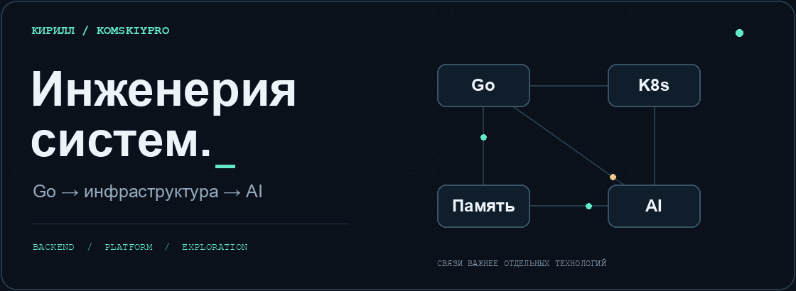
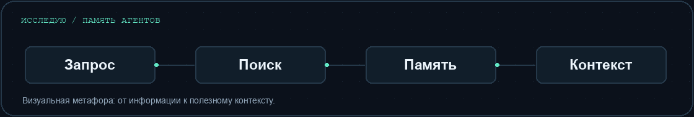

  <picture>
  <source media="(prefers-reduced-motion: reduce)" srcset="./assets/hero.png" />
  
  </picture>

  <b>Go-разработчик. Работаю над Kubernetes-операторами.</b> 
  Разбираюсь, как устроены системы — от сетевого пакета до контекста AI-агента.

  <a href="#что-мне-интересно">Интересы</a> ·
  <a href="#публичный-код">Публичный код</a> ·
  <a href="https://github.com/kk7453603?tab=repositories">Все репозитории</a>

---

### Что мне интересно

| Направление | Над чем работаю и что изучаю |
| :--- | :--- |
| **Go / Backend** | Конкурентность, API, границы сервисов и распределённые системы. |
| **Kubernetes / Platform** | Операторы, автоматизация инфраструктуры, Linux и контейнеры. |
| **AI / Память агентов** | Прорабатываю архитектуру памяти для AI-агентов: контекст, поиск и происхождение знаний. |
| **Локальные LLM** | Экспериментирую с запуском моделей на Apple Silicon и изучаю инфраструктуру инференса. |
| **Rust / Сети** | Изучаю Rust, сетевые протоколы, VPN-движки и устройство прокси. |

### Сейчас в фокусе

**Память AI-агентов** — как сохранять полезный контекст и находить нужные знания, не теряя связь с источником.

**SecondBrain** — веду связанную базу знаний: Go, Rust, системный дизайн, Kubernetes и AI. Стараюсь связывать теорию с кодом и практикой.

  <picture>
  <source media="(prefers-reduced-motion: reduce)" srcset="./assets/flow.png" />
  
  </picture>

### Публичный код

Учебные и экспериментальные проекты, в которых можно посмотреть мой код:

| Проект | Что внутри |
| :--- | :--- |
| [**AI · Personal Assistant**](https://github.com/kk7453603/AIAssistent) | AI-ассистент на Go: RAG, инструменты агента, интеграция с Obsidian и интерфейс на Tauri. |
| [**Go · Сервис ПВЗ**](https://github.com/kk7453603/avito_2025_summer) | Backend для пунктов выдачи заказов: Go, PostgreSQL, REST / gRPC, Docker. |
| [**Rust · Clean Architecture**](https://github.com/kk7453603/RUST-clean-architecture-RESTfull-API-example) | Шаблон REST API на Tokio и Axum с разделением архитектурных слоёв. |
| [**Go · REST API**](https://github.com/kk7453603/user_RESTfull_API) | API закладок: Gin, MongoDB, JWT и чистая архитектура. |

---

  Go — рабочая база. Rust, сети и AI-инфраструктура — то, что хочется разбирать глубже.

